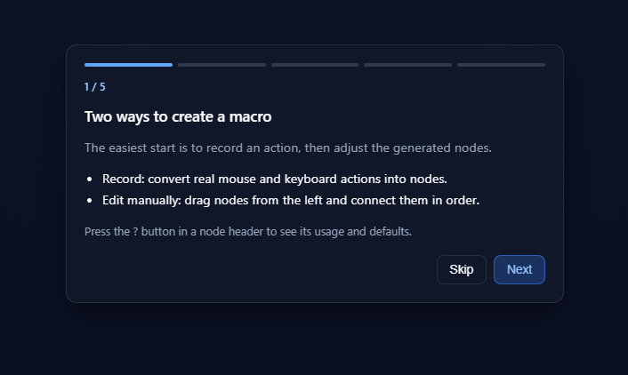

# D5 Macro

Build custom Windows macros by connecting nodes, without writing code.

D5 Macro combines a visual node editor with mouse and keyboard recording. Start with a recorded workflow, then add image recognition, conditions, and other nodes to make it more adaptable.

## Features

- **Visual node editor:** connect actions to build and edit your workflow.
- **Mouse and keyboard automation:** record and replay actions, or configure individual nodes.
- **Image recognition and branching:** respond to matching images and condition results rather than relying only on fixed delays.
- **Multi-monitor support:** automate across screens, with window-relative coordinates where appropriate.
- **Live feedback:** follow the current action and review execution logs.
- **Reusable scripts:** save and load JSON scripts, and optionally create a batch launcher to run a saved script.
- **English and Korean interface:** choose your preferred UI language.

## See it in action

### Create and connect nodes

### Capture an image and move the pointer to a match

### Record and replay typing

### Get started with the tutorial

## Before you buy

- **Platform:** Windows 10 or 11, 64-bit. The installed application runs locally and opens its editor in a browser. A separate Python or Node.js installation is not required.
- **Browser testing:** Chrome is the currently verified browser. Other browsers have not been fully tested.
- **Replay limitations:** window positions, display settings, browser zoom, page layout, and loading times can affect recorded actions. Image matching also depends on the target's appearance. Test workflows before using them for important tasks.
- **Permissions:** automation of elevated applications, protected software, or games is not guaranteed.
- **Installer signing:** the current installer is unsigned. Windows may display an unknown-publisher or SmartScreen warning.
- **Batch launchers:** a launcher can be moved to another folder on the same PC, but its referenced script and application must remain available.
- **Updates:** further improvements are planned. Please base your purchase on the features currently available.

## Support and feedback

Developed by **d051c**.

For problems, feature suggestions, or other questions, contact [yanche2990@gmail.com](mailto:yanche2990@gmail.com). Please include your application version and relevant logs when reporting a problem. Remove private information before sharing scripts or screenshots.

## About this repository

This public repository contains the product introduction and demo media. Application source code is maintained separately in a private development repository. This repository does not provide application installers or build instructions.
