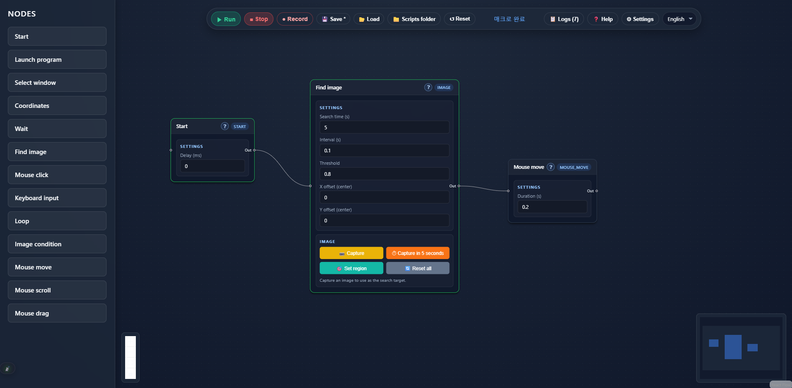
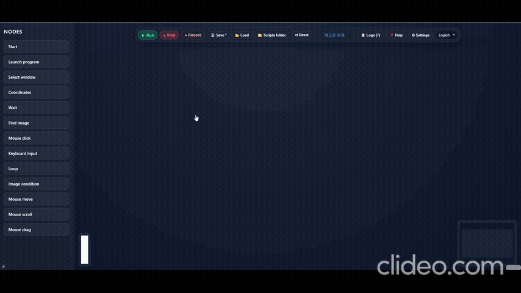
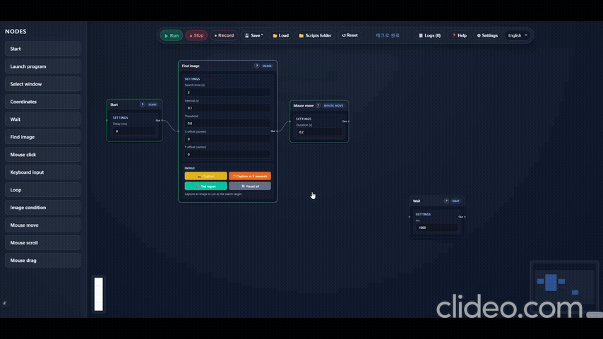
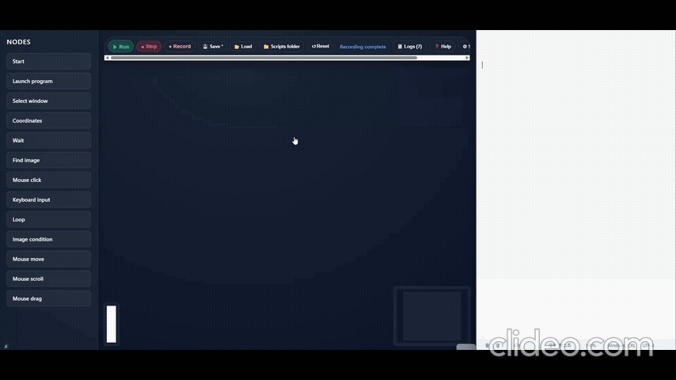

# Nodetavi Macro

**No-Code Windows Automation**

Turn repetitive Windows tasks into reusable workflows. Connect visual nodes to control mouse and keyboard actions, or record your actions and refine the resulting workflow without writing code.

**[Get Nodetavi Macro on Lemon Squeezy](https://d051c-macro.lemonsqueezy.com/checkout/buy/3efc95b4-a74f-4df1-b435-f2e1a44579d6)** · [License terms](docs/TERMS.md) · [Privacy](docs/PRIVACY.md)

This overview describes the prepared 1.0.19 build. Check the store for the version currently available to download. The store listing and older demonstration media may still show the previous D5 Macro name while the rename is being rolled out.

## Features

- **Visual workflow editor:** connect actions, waits, conditions, and loops. Resize nodes and insert new steps into existing connections.
- **Recording and playback:** capture mouse movements, clicks, held-button drag paths, scrolling, and keyboard input, then refine the generated nodes.
- **Image matching and branching:** use reference images to guide actions or choose branches. Test recognition against the current screen and inspect similarity scores.
- **Window selection:** pick an open window or configure matching criteria. Named references and current-run window targeting help distinguish multiple windows; ambiguous matches ask you to choose.
- **Workflow organization:** name and search nodes by name or ID, group related nodes, edit a group's contents, and save groups for reuse.
- **Execution and troubleshooting:** follow the active node, review current and recent run logs, and jump from a log entry to the relevant node.
- **Reusable scripts:** save and load JSON workflows, save changes to the loaded file, or create a separate copy with Save As.
- **Batch launchers:** optionally create a desktop launcher that starts the app if needed and runs the saved workflow.
- **Multi-monitor support:** use screen coordinates or window-relative coordinates.
- **English and Korean interface.**

## Getting started

Install Nodetavi Macro, open the browser-based editor, and follow the built-in tutorial. No separate Python or Node.js installation is required. This is a locally installed Windows application, not a cloud automation service.

## Demonstrations

These screenshots and GIFs show an earlier interface. Labels and layout may differ from the current build.

### Create and connect nodes

### Capture an image and move the pointer to a match

### Record and replay typing

## Before you buy

- **Platform:** Windows 10 or 11, 64-bit. macOS and Linux are not supported.
- **Browser testing:** the editor and website automation have been tested in Google Chrome. Other browsers have not been fully verified.
- **Coordinates:** display settings, window sizes, browser zoom, page layout, and loading times can affect playback. Window-relative coordinates compensate for window position, not changes in content layout.
- **Image matching:** appearance, scale, colors, and selection states can affect recognition. Reference images and similarity thresholds may need adjustment. This is image matching, not OCR.
- **Timing:** recording does not guarantee that a website or application has finished loading. Use image checks or appropriate waits.
- **Permissions:** elevated applications, protected software, and some games may restrict automated input.
- **IME input:** recording captures keyboard events, not finalized IME text. For Korean, Japanese, Chinese, or other IME input, review the recording and use text nodes where needed.
- **Windows and tabs:** selecting an application window does not directly select a browser tab. Configure or record tab-switching actions.
- **Older recordings:** information that was never captured cannot be recovered. Re-record relevant actions to use newer drag-path and window-reference behavior.
- **Installer signing:** the installer is unsigned. Windows may display an unknown-publisher or SmartScreen warning.
- **Batch launchers:** launchers can be moved on the same PC, but referenced scripts and the application must remain at their expected paths.
- **Updates:** purchase based on the features available today, rather than anticipated updates.

Always test workflows in a safe environment before using them on important files or accounts. Only run scripts and batch files from sources you trust. Use automation where you have permission and where it complies with the target service's rules.

## Support

Independently developed by **d051c**.

Contact [yanche2990@gmail.com](mailto:yanche2990@gmail.com) for bug reports, suggestions, or questions. Include your app version, Windows version, and relevant logs. Remove sensitive information before sharing scripts, logs, or screenshots.

## About this repository

This public repository contains product information and demonstration media. Application source code is maintained separately in a private development repository. This repository does not provide application installers or build instructions. The repository URL is retained so existing external links continue to work.

## License and third-party components

A purchase licenses one user for personal or business automation on devices they control. Redistribution or resale of the application is not permitted. Rights under third-party open-source licenses remain unaffected.

Review the [full license terms](docs/TERMS.md) before purchasing. See the [third-party notices](docs/THIRD_PARTY_NOTICES.md) and [LGPL library replacement guide](docs/LGPL_COMPLIANCE.md) for component-specific rights and instructions.
